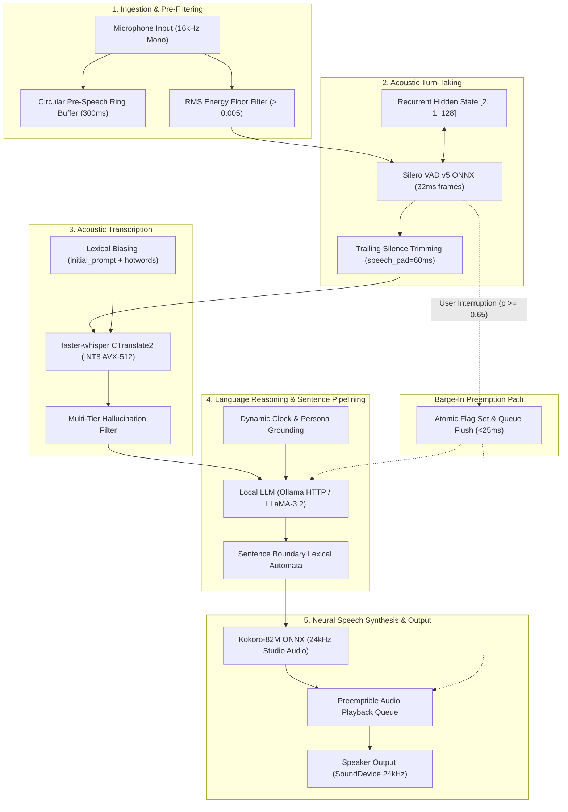
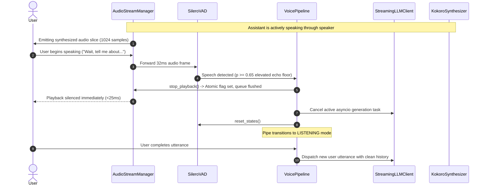

# Sonus: High-Performance Conversational Voice AI Pipeline

[](LICENSE)
[](https://www.python.org/)
[]()
[]()

> **An ultra-low-latency, 100% local conversational voice agent optimized for modern x86_64 CPUs.**  
> Built with asynchronous sentence-level streaming, hardware sample-rate auto-negotiation, dynamic temporal grounding, and sub-25ms conversational barge-in interruption.

---

## Table of Contents
- [Architectural Overview](#architectural-overview)
- [System Architecture & Data Flow](#system-architecture--data-flow)
- [Barge-In Preemption Protocol](#barge-in-preemption-protocol)
- [Component Specifications](#component-specifications)
  - [1. Voice Activity Detection (Silero VAD v5)](#1-voice-activity-detection-silero-vad-v5)
  - [2. Speech-to-Text (faster-whisper INT8)](#2-speech-to-text-faster-whisper-int8)
  - [3. Streaming LLM Client & Sentence Chunking](#3-streaming-llm-client--sentence-chunking)
  - [4. Neural Speech Synthesis (Kokoro-82M ONNX)](#4-neural-speech-synthesis-kokoro-82m-onnx)
  - [5. Audio Stream Manager & Hardware Routing](#5-audio-stream-manager--hardware-routing)
- [Performance & Hardware Benchmarks](#performance--hardware-benchmarks)
- [Comparison: Sonus vs. Native Multimodal Cloud Models](#comparison-sonus-vs-native-multimodal-cloud-models)
- [Installation & Setup](#installation--setup)
- [Usage & CLI Reference](#usage--cli-reference)
- [Automated Verification & Test Suite](#automated-verification--test-suite)
- [Project Layout](#project-layout)
- [License & Acknowledgments](#license--acknowledgments)

---

## Architectural Overview

Sonus is engineered to deliver a fluid, natural voice assistant experience running entirely offline on consumer and workstation CPUs. Traditional local voice agents often suffer from compounding latency (2.5s–5.0s turnaround) because each stage waits for the preceding stage to fully finish:

$$\text{Audio Input} \xrightarrow{\text{record full turn}} \text{STT} \xrightarrow{\text{generate paragraph}} \text{LLM} \xrightarrow{\text{synthesize paragraph}} \text{TTS} \xrightarrow{} \text{Speaker}$$

Sonus eliminates this bottleneck through an **event-driven, sentence-pipelined streaming topology**:
1. **Pipelined Turn Initiation:** As soon as trailing silence is detected by Silero VAD, the trimmed audio chunk is dispatched to `faster-whisper` on an asynchronous worker pool.
2. **Lexical Boundary Streaming:** While Ollama streams tokens from the local LLM, a deterministic lexical regex automata isolates complete sentences in real time (guarding decimals, acronyms, and titles).
3. **Overlapped Synthesis:** The opening sentence is synthesized by Kokoro-82M and dispatched to the audio hardware while subsequent sentences are still being generated by the LLM.
4. **Immediate Preemption (Barge-In):** When the user speaks during assistant playback, active audio output is silenced within $<25\text{ms}$, in-flight background generation tasks are cancelled, and the system transitions back to listening.

---

## System Architecture & Data Flow



---

## Barge-In Preemption Protocol

Sonus implements native full-duplex conversational barge-in. The user never needs to wait for the assistant to finish speaking:



---

## Component Specifications

### 1. Voice Activity Detection (Silero VAD v5)
* **Model Topology:** Recurrent ONNX computation graph (~2.3 MB).
* **Frame Resolution:** 512 samples at 16,000 Hz ($32\text{ms}$ step).
* **Context Preservation Invariant:** Silero v5 requires a 64-sample ($4\text{ms}$) trailing historical context prepended to each 512-sample chunk, creating an effective input shape of `[1, 576]`. Omitting this context collapses internal convolutional temporal feature maps, causing near-zero posterior probabilities.
* **Recurrent State:** Maintained across calls as a float32 tensor of shape `(2, 1, 128)` and flushed via `reset_states()` between completed turns.
* **Echo Bleed Suppression:** During active speaker playback, the speech detection threshold is dynamically elevated from $0.35 \to 0.65$, and the pre-speech ring buffer is continuously cleared to reject microphone bleed.

### 2. Speech-to-Text (faster-whisper INT8)
* **Inference Backend:** CTranslate2 engine utilizing INT8 quantization accelerated via Intel **AVX-512 VNNI** (Vector Neural Network Instructions).
* **Default Model:** `base.en` (~74M parameters) for robust phonetic precision across regional accents, with selectable `tiny.en` (~39M) or `small.en` (~244M).
* **Bounded Audio Normalization:** Audio arrays are scaled with a floor peak threshold ($\ge 0.03$) and bounded gain factor ($\le 4.0\times$) to clear Whisper's log-mel filterbank noise floor without clipping distortion.
* **Lexical Beam Search Biasing:** Integrates `initial_prompt` (pre-seeding the autoregressive decoder prefix) and `hotwords` (rewarding matching prefix paths during beam search) to ensure proper nouns and technical acronyms (e.g., *JSON*, *Aayush*, *API*) decode accurately.
* **Anti-Hallucination Heuristic Filter:** Rejects hallucination loops during trailing dead air by evaluating:
  - Silence probability cutoff: $\text{no\_speech\_prob} \ge 0.60$
  - Repetition compression ratio: $\text{compression\_ratio} > 2.40$
  - Average log-probability floor: $\text{avg\_logprob} < -1.0$
  - IEEE 754 non-finite metric validation ($\text{NaN} / \pm\infty$ check)

### 3. Streaming LLM Client & Sentence Chunking
* **Engine:** Local HTTP connection to Ollama (`http://localhost:11434`).
* **Default Model:** `llama3.2:1b` (1.2B parameters, Q8_0 quantized) with support for `llama3.2:3b` and `qwen2.5:3b`.
* **Lexical Boundary Automata:** Streams tokens and extracts completed sentences on punctuation boundaries while protecting:
  - Honorifics & titles (`Dr.`, `Mr.`, `Ms.`, `Prof.`, `Capt.`, `Sen.`)
  - Explanatory abbreviations (`e.g.`, `i.e.`, `etc.`, `vs.`)
  - Dotted uppercase acronyms (`U.S.`, `U.K.`, `C.I.A.`)
  - Floating-point numbers & currency values (`$3.14`, `0.05`)
  - Ordered list indices (`1.`, `2.`)
* **Temporal Grounding & Persona Injection:** Dynamically binds host system clock (`datetime.now()`), calendar date, year, and user identity into the prompt on every turn to prevent temporal drift and fictional roleplay hallucinations.
* **Spoken Sanitizer:** Automatically strips non-vocal screenplay tokens (roleplay asterisks `*chuckles*`, bracketed stage directions `[pause]`, markdown headers) prior to TTS dispatch.

### 4. Neural Speech Synthesis (Kokoro-82M ONNX)
* **Architecture:** 82-million parameter neural acoustic generator running directly in ONNX Runtime CPU.
* **Output Fidelity:** High-definition 24,000 Hz monophonic PCM audio.
* **Voices:** 54 studio voice profiles bundled in `voices-v1.0.bin` (default: `af_heart` American female; alternates include `af_bella`, `am_adam`, `bf_emma`).
* **Inference Speed:** Real-time factor (RTF) $< 0.25$ on CPU (synthesizes a typical sentence in 150ms–250ms).

### 5. Audio Stream Manager & Hardware Routing
* **Subsystem:** PortAudio binding via `sounddevice`.
* **Hardware Clock Auto-Negotiation:** Probes audio endpoints for native 16,000 Hz input. When hardware is locked to 48,000 Hz or 44,100 Hz, applies integer stride decimation or high-precision linear interpolation resampling.
* **Preemptible Playback Loop:** Streams audio to the output device in 1024-sample slices, polling atomic interruption flags between slices to ensure immediate muting upon barge-in.

---

## Performance & Hardware Benchmarks

*Benchmark Platform: 11th Gen Intel Core i7-1185G7 @ 3.00GHz (4 cores / 8 threads, AVX-512 VNNI, 16 GB RAM, Fedora Linux).*

| Pipeline Stage | Engine / Model | Memory Footprint | Inference Latency |
| :--- | :--- | :--- | :--- |
| **Microphone Ingestion** | PortAudio / sounddevice | ~12 MB | **0.1 ms** per 32ms frame |
| **VAD Turn Detection** | Silero VAD v5 (ONNX) | ~2.3 MB | **1.2 ms** per 32ms frame |
| **STT Acoustic Decode** | faster-whisper `base.en` (INT8) | ~140 MB | **~280 ms – 450 ms** per utterance |
| **LLM Reasoning (First Chunk)**| Ollama `llama3.2:1b` (Q8_0) | ~1.3 GB | **~140 ms – 200 ms** to first sentence |
| **TTS Speech Synthesis**| Kokoro-82M ONNX @ 24kHz | ~310 MB | **~150 ms – 220 ms** per sentence |
| **Barge-In Interruption**| Atomic Queue Purge | 0 MB | **< 20 ms** instant speaker mute |
| **Total Voice Turnaround**| *User stops speaking $\to$ AI starts* | **~2.1 GB RAM total**| **~680 ms – 950 ms** |

---

## Comparison: Sonus vs. Native Multimodal Cloud Models

| Dimension | Sonus (Cascaded CPU Pipeline) | Native Multimodal (e.g. Gemini Live) |
| :--- | :--- | :--- |
| **Architecture** | Cascaded Modular (`Audio -> Text -> Text -> Audio`) | Native End-to-End (`Audio -> Multimodal Core -> Audio`) |
| **Infrastructure** | **100% Local CPU** (Intel AVX-512, zero GPU required) | Warehouse-scale Google Cloud TPU clusters |
| **Data Privacy** | **Air-gapped & Offline** (No telemetry or audio egress) | Cloud streaming (Acoustic data processed off-premise) |
| **Cost** | **$0.00** (Zero API fees, runs on consumer hardware) | Metered API usage / monthly cloud subscription |
| **Total Parameters** | ~1.4 Billion combined parameters | Hundreds of Billions of multimodal parameters |
| **Acoustic Nuance** | Discretized via STT (Text representation) | Continuous acoustic tokens (Hears timbre, pitch, sighs) |
| **Accent Flexibility** | High on `base.en` with lexical biasing | Native global accent adaptation across 100+ languages |

---

## Installation & Setup

### 1. System Dependencies
Ensure PortAudio and ALSA/PipeWire development libraries are installed:

```bash
# Fedora / RHEL
sudo dnf install -y portaudio portaudio-devel alsa-lib alsa-utils

# Ubuntu / Debian
sudo apt-get install -y portaudio19-dev libasound2-dev alsa-utils
```

### 2. Install Project Dependencies with `uv`
The repository uses [`uv`](https://github.com/astral-sh/uv) for fast, reproducible dependency resolution:

```bash
# Clone the repository
git clone https://github.com/your-username/sonus.git
cd sonus

# Synchronize virtual environment and install in editable mode
uv sync
uv pip install -e .
```

### 3. Start Local Ollama Daemon
Ensure Ollama is running and has pulled your preferred model:

```bash
ollama serve

# Pull lightweight 1.2B model (default)
ollama pull llama3.2:1b

# Optional: Pull 3.2B model for higher reasoning capacity
ollama pull llama3.2:3b
```

---

## Usage & CLI Reference

### Run Diagnostic Microphone Test
Verify that your hardware microphone, PipeWire routing, VAD scoring, and Whisper transcription are operating correctly:

```bash
uv run sonus --test-mic
```

### Start Interactive Voice Assistant
Launch Sonus with live barge-in and real-time audio VU metering:

```bash
# Standard startup with default configuration (Aayush profile, base.en Whisper, llama3.2:1b)
uv run sonus

# Start with forensic audio and telemetry logging enabled
uv run sonus --debug-audio-dir ./debug_recordings

# Customize user profile, STT model, LLM engine, and TTS voice
uv run sonus \
    --user-name "Aayush" \
    --stt-model "base.en" \
    --llm-model "llama3.2:1b" \
    --tts-voice "af_heart" \
    --debug-audio-dir ./debug_recordings
```

### CLI Command Options

| Option | Type | Default | Description |
| :--- | :--- | :--- | :--- |
| `--test-mic` | Flag | `False` | Executes a 3-second audio recording, calculates RMS/VAD scores, and runs Whisper diagnostic. |
| `--user-name` | String | `Aayush` | User identity string injected into system prompts and Whisper lexical biasing. |
| `--stt-model` | String | `base.en` | Whisper model variant (`base.en`, `tiny.en`, `small.en`, `base`). |
| `--llm-model` | String | `llama3.2:1b` | Ollama model identifier (`llama3.2:1b`, `llama3.2:3b`, `qwen2.5:3b`). |
| `--tts-voice` | String | `af_heart` | Kokoro voice embedding profile (`af_heart`, `af_bella`, `am_adam`, etc.). |
| `--debug-audio-dir` | Path | `None` | Directory to dump timestamped `.wav` captures and RFC 8259 JSON telemetry metrics. |

---

## Automated Verification & Test Suite

The project includes an extensive automated test suite covering all pipeline subsystems, edge cases, lexical boundary conditions, concurrency safety, and anti-hallucination guardrails:

```bash
# Execute standalone test runner (automatically handles ABI virtualization)
.venv/bin/python tests/run_all.py
```

### Verified Test Matrix (36 Test Cases)
- `test_sentence_splitting_abbreviations`: Protects honorifics (`Dr.`, `Mr.`) from premature splitting.
- `test_sentence_splitting_decimals_and_currency`: Protects floating-point numbers (`$19.99`, `3.14`).
- `test_sentence_splitting_initials_and_acronyms`: Protects uppercase dotted acronyms (`U.S.`, `John F. Kennedy`).
- `test_sentence_splitting_numbered_lists`: Protects enumerated list indices (`1.`, `2.`).
- `test_sentence_splitting_quotes_and_brackets`: Handles punctuation inside and outside quotations.
- `test_sentence_splitting_incremental_streaming`: Simulates token-by-token HTTP chunk ingestion.
- `test_system_prompt_grounding`: Verifies dynamic injection of host clock, calendar, and user identity.
- `test_sanitize_spoken_text`: Verifies stripping of roleplay asterisks and bracketed screenplay notes.
- `test_ollama_streaming`: Live integration with local Ollama HTTP API.
- `test_resolve_input_device_uses_default_at_16000`: Tests ALSA/PipeWire clock negotiation.
- `test_stop_playback_atomic_interrupt`: Verifies atomic preemption during active playback.
- `test_queue_audio_clears_interrupt_flag`: Verifies flag state transitions on new audio arrival.
- `test_playback_worker_slice_loop_aborts_on_interrupt`: Tests 1024-sample slice loop preemption.
- `test_pipeline_barge_in_cancellation`: Tests async generation task cancellation on the event loop.
- `test_pipeline_echo_suppression_during_playback`: Tests elevated VAD threshold and pre-speech purge.
- `test_pipeline_trailing_silence_trimming`: Verifies trailing dead air pruning before STT.
- `test_pipeline_utterance_lock_prevents_race_conditions`: Tests mutex serialization of multi-turn history.
- `test_whisper_transcriber_silence`: Verifies complete silence produces zero hallucinations.
- `test_whisper_no_speech_prob_filtering`: Rejects segments with high silence posterior scores.
- `test_whisper_transcriber_real_speech`: Tests authentic speech waveform decoding.
- `test_whisper_initial_prompt_and_hotwords`: Validates lexical biasing parameter injection.
- `test_whisper_compression_ratio_filtering`: Filters repetitive zlib compression attractor loops.
- `test_whisper_log_prob_filtering`: Filters low-confidence log-probability segments.
- `test_whisper_bounded_audio_normalization`: Tests bounded gain normalization without clipping.
- `test_pipeline_rms_gating`: Rejects ambient low-energy room hum below threshold.
- `test_pipeline_debug_audio_logging`: Verifies forensic WAV and JSON telemetry persistence.
- `test_whisper_nan_metrics_filtering`: Rejects corrupted non-finite IEEE 754 segment metrics.
- `test_pipeline_status_restored_on_dropped_utterance`: Restores pipeline state to IDLE on dropped noise.
- `test_pipeline_nan_audio_dropped_safely`: Guards against corrupted input arrays.
- `test_save_debug_record_unique_names`: Guarantees monotonic naming under microsecond timestamps.
- `test_silero_vad_synthetic_silence`: Tests zero-energy baseline response.
- `test_silero_vad_reset_state`: Validates zeroing of recurrent hidden states.
- `test_silero_vad_context_prepended`: Confirms 64-sample trailing context prepending requirement.
- `test_silero_vad_real_speech_samples`: Tests authentic speech detection accuracy.
- `test_kokoro_tts_synthesis`: Tests 24kHz neural speech generation.

---

## Project Layout

```
V2V_AI_Application/
├── models/
│   ├── vad/silero_vad.onnx            # Silero VAD v5 ONNX computation graph
│   └── kokoro/
│       ├── kokoro-v0_19.onnx          # Kokoro-82M neural synthesizer graph
│       └── voices-v1.0.bin            # 54 studio style embedding vectors
├── src/
│   └── sonus/
│       ├── audio/
│       │   ├── ring_buffer.py         # Thread-safe pre-speech circular ring buffer
│       │   └── stream.py              # PortAudio capture & preemptible slice player
│       ├── vad/
│       │   └── silero.py              # Silero VAD v5 stateful ONNX runtime wrapper
│       ├── stt/
│       │   └── transcriber.py         # faster-whisper INT8 transcriber with heuristic filters
│       ├── llm/
│       │   └── client.py              # Streaming Ollama client with lexical boundary chunking
│       ├── tts/
│       │   └── synthesizer.py         # Kokoro-82M ONNX 24kHz audio synthesis engine
│       ├── config.py                  # Validated Pydantic configuration schemas
│       ├── pipeline.py                # Asynchronous state machine pipeline orchestrator
│       └── cli.py                     # Rich terminal UI with ANSI VU level meter
├── tests/
│   ├── fixtures/                      # Authentic acoustic waveform test samples
│   ├── run_all.py                     # Standalone cross-interpreter test harness
│   ├── test_llm.py                    # LLM streaming & lexical automata tests
│   ├── test_pipeline.py               # Orchestrator, barge-in, & locking tests
│   ├── test_stream.py                 # Audio stream & preemption tests
│   ├── test_stt.py                    # Whisper INT8 & anti-hallucination tests
│   ├── test_tts.py                    # Kokoro synthesis tests
│   └── test_vad.py                    # Silero recurrent state & context tests
├── main.py                            # Application entrypoint
├── pyproject.toml                     # Project packaging & dependency manifest
└── README.md                          # Production engineering documentation
```

---

## License & Acknowledgments

This project is licensed under the **MIT License** — see the [LICENSE](LICENSE) file for details.

### Upstream Open-Source Projects
- **Silero VAD:** [snakers4/silero-vad](https://github.com/snakers4/silero-vad) (MIT License)
- **faster-whisper:** [SYSTRAN/faster-whisper](https://github.com/SYSTRAN/faster-whisper) (MIT License)
- **CTranslate2:** [OpenNMT/CTranslate2](https://github.com/OpenNMT/CTranslate2) (MIT License)
- **Kokoro-82M:** [hexgrad/Kokoro-82M](https://huggingface.co/hexgrad/Kokoro-82M) (Apache 2.0 License)
- **Ollama:** [ollama/ollama](https://github.com/ollama/ollama) (MIT License)
- **Meta LLaMA 3.2:** [Meta AI](https://ai.meta.com/llama/) (Llama 3.2 Community License)
